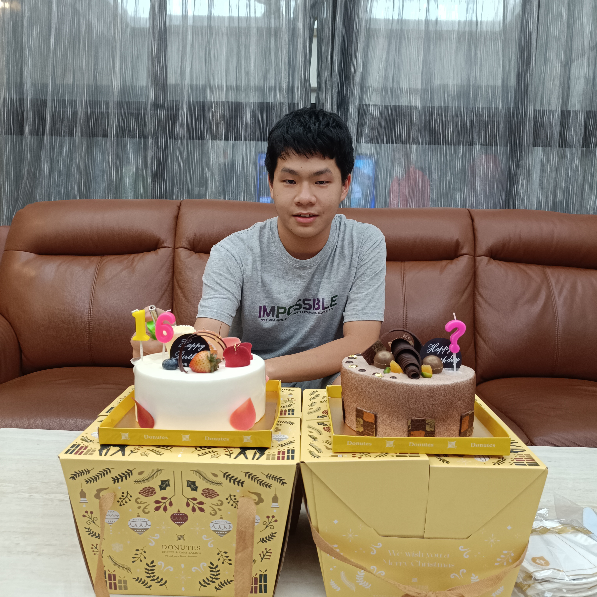
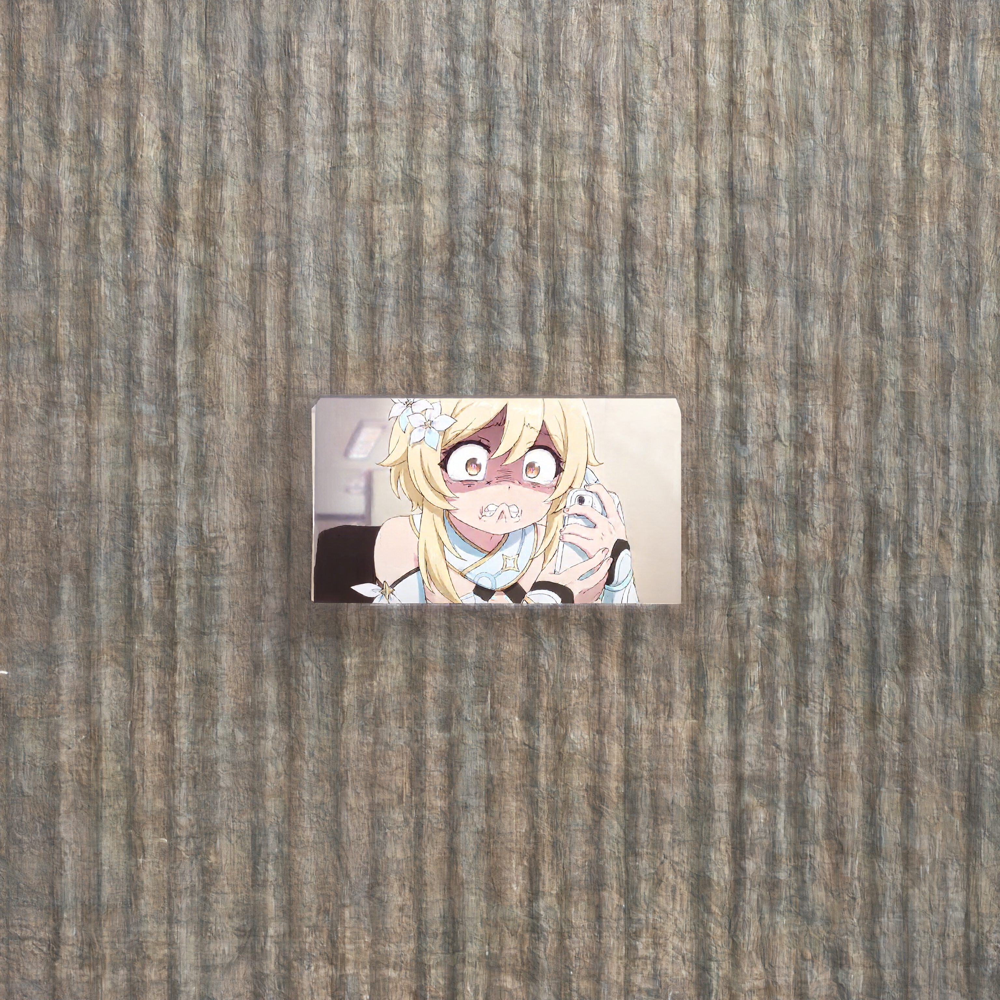
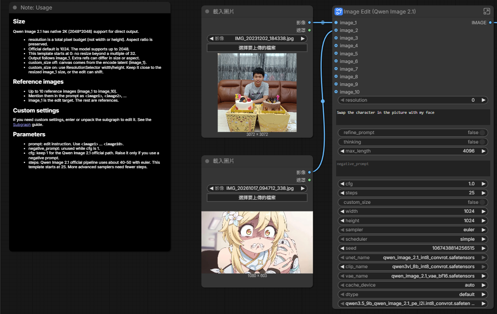
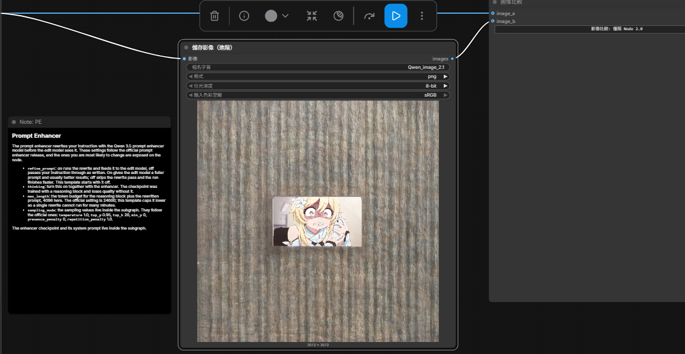

# comfyUI生成圖片
- 原圖

- 生成的圖

- 完整工作流截圖

- 提示詞
 Swap the character in the picture with my face

- 個人心得
最一開始我是用兩張動漫圖結合在一起，那個時候我沒改提示詞但結果是成功的，但當我改了提示詞後，結果呈現的卻是跟我想要生成的圖片截然不同，我找了資料後發現，有可能是因為這個模型沒辦法精準的抓住兩張圖的臉，或是我本身的語意沒表達清楚導致圖是錯的。之後可能要去躲利用一些相關的模型才能做出我想要的效果。
